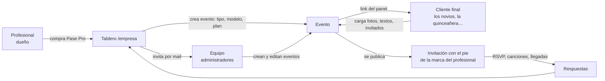

# Amo Invitar para profesionales (wedding planners, salones, fotógrafos, agencias)

> Estado: **diseño para aprobar** (ronda 32). Ya funciona: las reglas del pie de marca blanca y las tablas base
> (`empresas`, `miembros`, `accesos_evento`). Falta: el tablero `/empresa`, la carga de logo, los administradores,
> los créditos y el cobro. El orden para armarlo está en la sección 7.

## 1. Qué resuelve

Un profesional organiza muchos eventos al año. Hoy tendría que comprar, entrar y administrar cada invitación por
separado y todas salen con la marca de Amo Invitar. Con el panel Pro:

- ve **todos sus eventos en un solo tablero** (estado, confirmaciones, vencimientos);
- suma **usuarios administradores** (su equipo) con permisos distintos;
- carga **un logo (o un texto) una sola vez** y se aplica a todas sus invitaciones;
- paga **precio mayorista** por invitación.

## 2. Cómo se usa



1. El profesional entra con su mail (Google o link) y crea su **empresa** (nombre, rubro).
2. Compra el **Pase Pro** (ver sección 6) y, si quiere, un pack de créditos.
3. Desde el tablero crea eventos. Cada evento publicado usa un **crédito** del plan elegido.
4. Puede cargarlo todo él o mandarle al cliente el link del panel del evento.
5. En el tablero ve todos los eventos y exporta.

## 3. Usuarios y permisos

| | Dueño | Administrador | Solo lectura | Cliente final |
|---|---|---|---|---|
| Ver todos los eventos de la empresa | ✓ | ✓ | ✓ | solo el suyo |
| Crear y editar eventos | ✓ | ✓ | – | el suyo |
| Publicar (usa un crédito) | ✓ | ✓ | – | según lo que permita la empresa |
| Ver confirmaciones y exportar | ✓ | ✓ | ✓ | las suyas |
| Agregar o quitar administradores | ✓ | – | – | – |
| Logo, texto y pie de marca blanca | ✓ | – | – | – |
| Comprar créditos y ver facturas | ✓ | – | – | – |

- Los administradores se invitan **por mail** (entran con ese mail; sin contraseñas, como el resto del sistema).
- Cantidad de administradores incluidos según el Pase (sección 6); se pueden sumar.
- Ya existe `miembros(empresa_id, usuario_id, rol)` con `duenio | editor | lectura`: se usan esos roles
  (en pantalla: Dueño · Administrador · Solo lectura).

## 4. Marca blanca (reglas cerradas)

Se configura **una vez, en la empresa**, y se aplica a todos sus eventos (publicados y futuros).

| Opción en el panel | Qué pasa en el pie de la invitación |
|---|---|
| **Logo propio** (PNG/SVG/WEBP, fondo transparente) | Se muestra su logo en lugar del de Amo Invitar |
| **Texto** (si no tiene logo o no quiere cargarlo) | Se muestra su texto, p. ej. «Salón La Esperanza · Eventos desde 1998» |
| Logo **y** texto | Se muestran los dos |
| **Sin pie** (interruptor «No mostrar pie») | La invitación no lleva ningún pie |

Reglas que ya aplica el código (`src/componentes/bloques.js`):

- **Nunca hay links** en el pie con marca blanca: ni a amoinvitar.com ni uno propio del profesional.
- El logo de Amo Invitar **no aparece** en el pie, en la pantalla del PIN ni en «Busca tu mesa».
- Con la marca blanca activa y sin logo, sin texto o con «No mostrar pie», no se dibuja el pie.
- Los mails que salen para esos eventos llevan el nombre de la empresa como remitente (a definir).

Se guarda en `empresas.marca` (JSON):

```json
{
  "blanca": true,
  "nombre": "Salón La Esperanza",
  "logo": "/media/empresas/em_x7k2/logo.png",
  "pie": "Salón La Esperanza · Eventos desde 1998",
  "sinPie": false
}
```

(`web` ya no se usa: el pie no lleva links.)

## 5. Pantallas del tablero `/empresa`

```
┌──────────────────────────────────────────────────────────────┐
│ [logo]  Salón La Esperanza            Créditos: 12   [Equipo] │
├──────────────────────────────────────────────────────────────┤
│ [+ Nuevo evento]   Buscar…            Estado ▾  Tipo ▾        │
│ ┌────────────────────────────────────────────────────────┐   │
│ │ Sofi & Ale · Boda · Deluxe     38/52 confirmaron  ●Activa │   │
│ │ Camila · 15 años · Premium     12/80 confirmaron  ●Borrador│  │
│ │ Bautismo Mateo · Basic         vence en 9 días    ●Activa │   │
│ └────────────────────────────────────────────────────────┘   │
├──────────────────────────────────────────────────────────────┤
│ Pestañas: Eventos · Equipo · Marca · Créditos y facturas      │
└──────────────────────────────────────────────────────────────┘
```

- **Eventos**: lista con estado, plan, confirmaciones y vencimiento; «Abrir panel» lleva al panel normal del evento.
- **Equipo**: lista de administradores, «Invitar por mail», cambiar rol, quitar.
- **Marca**: subir logo, texto del pie, interruptor «No mostrar pie» y **vista previa del pie** sobre un modelo.
- **Créditos y facturas**: saldo, comprar packs, historial de compras.

## 6. Cómo cobrarlo (propuesta para decidir)

Principios: el cliente final sigue pagando **una vez, sin suscripciones**; el profesional paga una **cuota anual
simple** (no mensual) y luego **precio mayorista por invitación**. Tu costo por evento es casi cero (Cloudflare),
así que el descuento por volumen es margen que podés dar sin miedo; lo que hay que proteger es el valor de la
marca blanca (por eso va solo en planes Pro).

### Opción recomendada: Pase Pro anual + créditos con descuento por volumen

| | **Pro** | **Studio** |
|---|---|---|
| Para quién | Planner o fotógrafo independiente | Salón, agencia o equipo |
| Cuota anual (pago único al año) | a definir | a definir |
| Administradores incluidos | 2 | 10 |
| Marca blanca (logo, texto, sin pie) | ✓ | ✓ |
| Tablero con todos los eventos | ✓ | ✓ |
| Soporte | normal | prioritario |

Créditos (1 crédito = 1 invitación publicada del plan elegido), con descuento sobre el precio de lista:

| Compra | Descuento sugerido |
|---|---|
| Pack 10 | 25 % |
| Pack 25 | 35 % |
| Pack 50 | 40 % |
| Pack 100 o más | 45 % o a medida |

Notas:
- Los porcentajes y las cuotas son **hipótesis para probar**, no cifras definitivas. Con los precios actuales
  (Basic 29 €, Premium 45 €, Deluxe 70 €) un pack 25 de Premium saldría ~29 € cada uno: sigue siendo competitivo
  frente a las plataformas de invitaciones y deja margen.
- Los créditos **no vencen** mientras el Pase esté vigente; si el Pase vence, el saldo se conserva 12 meses.
- Diseño a medida: se cotiza aparte (hoy 140 €); con descuento Studio si trae volumen.
- Cobro: como el resto del sistema (Stripe, PayPal, Mercado Pago, transferencia). El Pase anual y los packs son
  **productos de pago único** (no hace falta Stripe Billing ni débitos automáticos), y se factura igual que hoy.
  Renovación: aviso por mail 30 días antes.
- Lo que **no** conviene: dar marca blanca gratis o con créditos sueltos (se pierde el incentivo del Pase), ni una
  mensualidad (choca con el mensaje «sin suscripciones»).

Alternativa más simple para empezar: **sin cuota**, solo packs con descuento y marca blanca desde 25 créditos.
Es más fácil de vender al comienzo, pero deja menos ingreso recurrente.

## 7. Orden para armarlo

1. **Hecho:** reglas del pie (sin links, logo o texto, sin pie), límite de 35 invitados en Gratis.
2. Tabla `empresas` ya existe; agregar migración con `marca`, `sinPie`, pase (`plan`, `vence`) y créditos
   (`creditos` ya existe) + tabla de movimientos de créditos.
3. Pantalla **Marca** (subir logo a R2, texto, interruptor, vista previa).
4. Tablero **Eventos** (lista, crear evento, abrir panel).
5. **Equipo** (invitar administradores por mail, roles).
6. **Créditos y cobro** (packs, Pase Pro, facturas).
7. Página pública para profesionales en la web (`/profesionales`) con el formulario de contacto actual.

## 8. Otros detalles

- **Dominio propio** (`invitaciones.salon.com`) queda para una etapa posterior (`empresas.dominio` ya existe).
- **Cliente final del profesional**: no ve ninguna mención de Amo Invitar en su panel (logo y colores de la empresa).
- Los eventos de una empresa **no se mezclan** con los de otra: toda consulta del tablero filtra por `empresa_id`.
