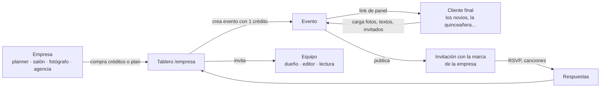
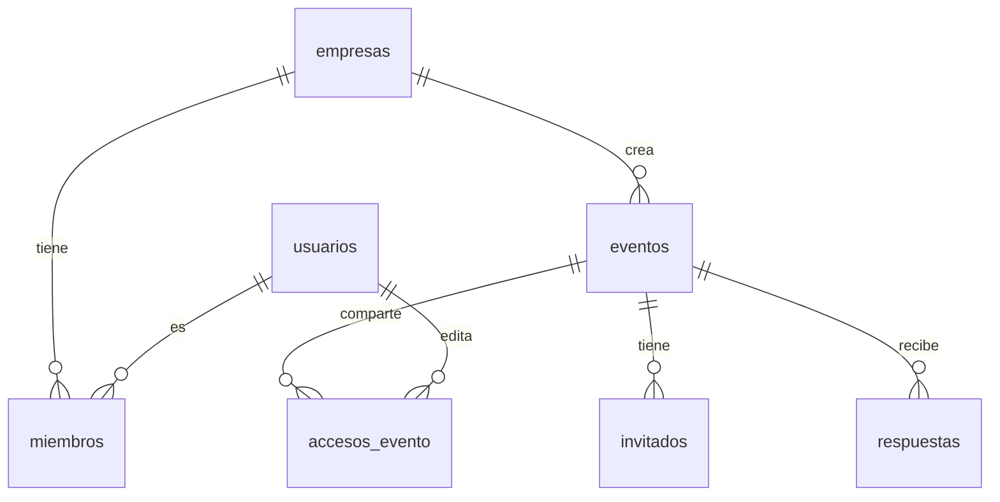

# Amo Invitar para empresas

Para **wedding planners, salones, fotógrafos y agencias**: un panel multi-evento,
con marca blanca (su logo y sus colores) y precios mayoristas.

> Estado: **propuesta**. Las tablas ya están en `migrations/0001_inicial.sql`. La marca blanca
> ya funciona en la invitación (pie con su logo), en el panel del cliente
> (logo y colores) y en la pantalla de PIN. El tablero `/empresa`, los
> créditos y los dominios propios están pendientes.

## Cómo se usa



1. La empresa se registra y elige plan (o compra un pack de créditos).
2. Desde su tablero crea eventos: tipo, modelo, paquete. Cada evento usa un crédito.
3. Puede cargar todo ella misma o mandarle al cliente el link del panel.
   El cliente ve el panel **con el logo y los colores de la empresa**, sin
   ninguna mención a Amo Invitar.
4. La invitación sale con el pie de la empresa (logo, nombre y su web), o sin
   pie si el plan lo permite.
5. En el tablero ve todos los eventos: estado, confirmaciones, canciones,
   vencimientos, y puede exportar.

## Qué ve cada uno

| | Empresa (dueño) | Equipo (editor) | Cliente final |
|---|---|---|---|
| Ver todos los eventos | ✓ | ✓ | solo el suyo |
| Crear eventos (usa créditos) | ✓ | ✓ | – |
| Cambiar modelo o paquete | ✓ | ✓ | – |
| Cargar textos, fotos, invitados | ✓ | ✓ | ✓ |
| Publicar | ✓ | ✓ | según lo que elija la empresa |
| Ver confirmaciones | ✓ | ✓ | ✓ (las suyas) |
| Marca, colores, dominio, facturación | ✓ | – | – |

## Marca blanca

Se guarda en `empresas.marca` (JSON):

```json
{
  "blanca": true,
  "nombre": "Salón La Esperanza",
  "logo": "/media/empresas/em_x7k2/logo.png",
  "colores": { "principal": "#1d3557", "texto": "#ffffff" },
  "web": "https://salonlaesperanza.com",
  "pie": "Salón La Esperanza · Eventos desde 1998",
  "remitente": "Salón La Esperanza <invitaciones@amoinvitar.com>"
}
```

| Dónde aparece | Qué cambia |
|---|---|
| Panel del cliente | logo arriba, color de botones y acentos |
| Invitación | el pie de Amo Invitar se reemplaza por el de la empresa |
| Pantalla de PIN | logo y color de la empresa |
| Mails (link del panel, recordatorios) | nombre del remitente y logo |
| Demos para mostrar a sus clientes | `/demo/garden?empresa=em_x7k2` con su pie |
| Dominio propio (opcional) | `invitaciones.salonlaesperanza.com/boda/sofi-y-ale` |

El dominio propio se hace con **Cloudflare for SaaS** (custom hostnames): la
empresa apunta un CNAME a nuestro dominio y el Worker reconoce la empresa por
el host. Cloudflare emite el certificado solo.

## Planes (borrador para decidir)

| Plan | Para quién | Qué incluye | Precio orientativo |
|---|---|---|---|
| **Por evento** | quien hace pocos eventos | precio de lista −20 %, tablero, marca en el panel | sin cuota |
| **Pro** | planners y fotógrafos | 5 créditos Premium por mes, marca blanca completa | 79 €/mes |
| **Salón / Agencia** | muchos eventos | 15 créditos, equipo de hasta 10 personas, dominio propio | 179 €/mes |
| Créditos extra | todos | Basic 15 € · Premium 40 € · Deluxe 70 € | – |

Los créditos que no se usan se acumulan hasta 3 meses. Cambiar un evento a un
paquete mayor descuenta la diferencia.

## Datos (ya en `migrations/0001_inicial.sql`)



- `empresas`: nombre, rubro, plan, créditos, marca (JSON), dominio.
- `miembros`: quién del equipo entra y con qué rol.
- `eventos.empresa_id`: el evento es de una empresa (marca blanca).
- `accesos_evento`: el cliente final, con su mail, puede editar solo su evento.

## Lo que falta construir

1. Login (Google y link mágico por mail, como en Albunear) para usuarios y equipos.
2. Tablero `/empresa`: lista de eventos con filtros, crear evento, ver respuestas, exportar.
3. Créditos y planes en la tienda (Stripe con suscripción mensual).
4. Editor de marca (subir logo, elegir colores, vista previa del pie y del panel).
5. Dominios propios con Cloudflare for SaaS.
6. Demos con la marca de la empresa para que las muestre a sus clientes.
